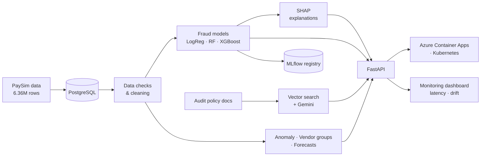

# AuditLens

**A machine-learning platform that helps auditors find risky financial transactions, explain why each one
was flagged, and answer audit-policy questions with citations.**


Auditors usually test a small sample of a client's transactions. AuditLens scores **all** of them, ranks
the riskiest, and tells the auditor *why*, so their time goes where the risk is.

---

## Results on 6.36 million real PaySim transactions

| | |
|---|---|
| **Fraud detection** | **99.7% recall**, 1.00 precision, 1.00 ROC-AUC on a held-out future period; the built-in rule caught 0.2% |
| **Anomaly detection** (no labels) | 0.995 ROC-AUC: 68% of its flags are real fraud |
| **Vendor segmentation** | 382K vendors in 4 behaviour groups; the riskiest has 2.5–6× the fraud exposure of the others |
| **Spend forecasting** | 4.0% MAPE on daily cash-out spend |
| **Policy assistant** | 92% on a 25-question test set, every answer cited, out-of-scope questions declined |
| **Engineering** | FastAPI on Docker and Azure, MLflow model registry, drift monitoring, 31 automated tests in CI |

> PaySim is a public *simulated* dataset, and its fraud follows simple patterns, which explains the very
> high scores. The [model card](MODEL_CARD.md) covers this and the other limitations.

---

## What it does

| An auditor asks… | AuditLens answers with… |
|---|---|
| "Which transactions look like fraud?" | A risk score for each transaction, with the top reasons (SHAP) |
| "What looks unusual, even if it's new?" | A label-free anomaly score (Isolation Forest) |
| "Which vendors behave oddly?" | Vendor groups ranked by fraud exposure (K-Means) |
| "Is spending on track?" | A spend forecast with a confidence range (SARIMA / Prophet) |
| "What does our policy say about this?" | An answer from the policy documents, with citations (RAG + Gemini) |
| "Explain this flag in plain English." | A short written explanation built from the model's reasons |

Example: one call to `/predict` returns:

```json
{
  "fraud_score": 0.98, "flagged": true, "risk_band": "high", "anomaly_flag": true,
  "reasons": [
    {"description": "sender balance doesn't reconcile", "direction": "raises risk"},
    {"description": "amount vs. sender balance",        "direction": "raises risk"}
  ],
  "narrative": "This transfer emptied the sender's account in one transaction and the receiver's balance did not change..."
}
```

---

## How it works



## Tech stack

| Area | Tools |
|---|---|
| Data | PostgreSQL, SQL, Pandas, NumPy, Pandera |
| Machine learning | scikit-learn, XGBoost, Optuna, Isolation Forest, K-Means, statsmodels (SARIMA), Prophet |
| Explainability | SHAP, error and segment analysis |
| GenAI | Gemini, sentence-transformer embeddings, Chroma / pgvector, retrieval with citations |
| MLOps | MLflow (tracking + registry), Evidently (drift), structured logging, Streamlit |
| Serving & cloud | FastAPI, Docker, Kubernetes (minikube), Azure Container Apps, Azure ML |
| Quality | pytest (31 tests), ruff, GitHub Actions, Azure DevOps |

## Run it

```bash
pip install -e ".[genai,monitoring,dev]"
auditlens generate --rows 200000     # sample data (or ./scripts/download_paysim.sh for real PaySim)
auditlens train                      # trains every model and writes reports/
auditlens serve                      # API at http://localhost:8000/docs
```

## Learn more

- **[Project guide](docs/project-guide/README.md)**: every build step, design decision, outcome and deployment instruction
- **[Model card](MODEL_CARD.md)**: data, metrics, risks and limitations
- **[Architecture](docs/architecture.md)**: detailed system diagram
- **[Reports](reports/)**: data-quality report, model comparison, SHAP, forecasts, evaluation results

---

*Built by [M Naga Jaideep Chowdary](https://github.com/nagajaideep). MIT licensed.*
