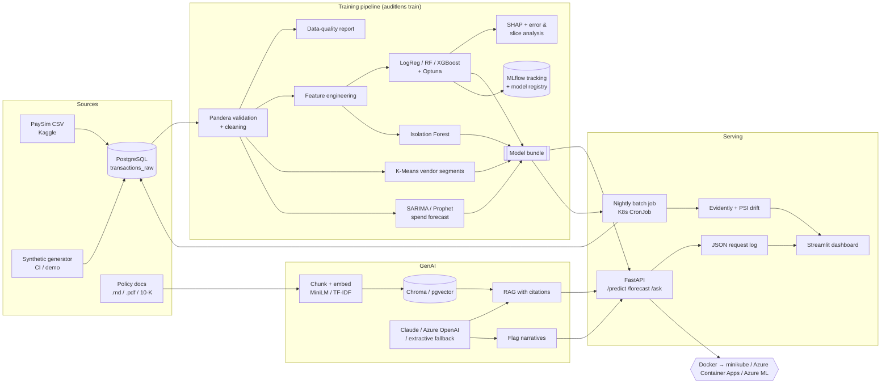

# Architecture

## Request flow for `/predict`
1. Pydantic validates the transaction (types, non-negative amounts, account-id format).
2. `build_features` derives the same 21 features used in training.
3. The registered classifier returns a fraud probability, compared with the threshold tuned on validation data.
4. Isolation Forest adds a label-free anomaly score.
5. SHAP TreeExplainer returns the top four signed feature contributions.
6. Optionally, the LLM turns those contributions into a 2–4 sentence note for the auditor. The prompt
   forbids reasons that aren't in the SHAP output.
7. Middleware writes one JSON line per request (latency, status, number flagged), which the dashboard reads.
