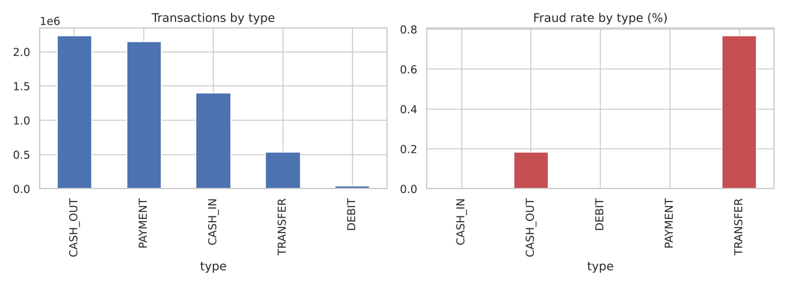
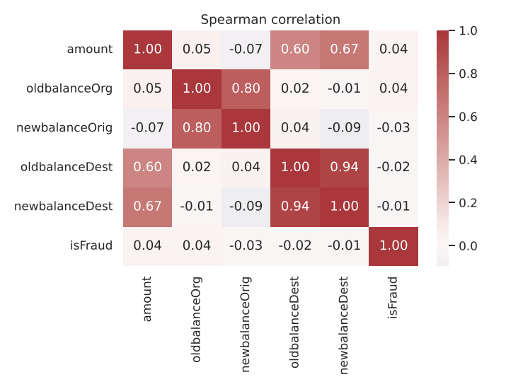

# AuditLens data-quality report

- Rows in: **6,362,620**, rows after cleaning: **6,362,620**
- Duplicates removed: 0
- Nulls imputed: none
- Negative values clipped: none
- Fraud rate: **0.1291%** (8,213 cases) — heavy class imbalance
- PaySim's built-in `isFlaggedFraud` rule catches 16 of 8213 frauds (recall 0.19%) — the rule-based baseline any model must beat.

## Schema validation (Pandera, raw data)

No failures.

## Column profile (raw)

| column         | dtype   |   nulls |   null_pct |   unique |   min |           max |
|:---------------|:--------|--------:|-----------:|---------:|------:|--------------:|
| step           | int64   |       0 |          0 |      743 |     1 | 743           |
| type           | object  |       0 |          0 |        5 |       |               |
| amount         | float64 |       0 |          0 |  5316900 |     0 |   9.24455e+07 |
| nameOrig       | object  |       0 |          0 |  6353307 |       |               |
| oldbalanceOrg  | float64 |       0 |          0 |  1845844 |     0 |   5.9585e+07  |
| newbalanceOrig | float64 |       0 |          0 |  2682586 |     0 |   4.9585e+07  |
| nameDest       | object  |       0 |          0 |  2722362 |       |               |
| oldbalanceDest | float64 |       0 |          0 |  3614697 |     0 |   3.56016e+08 |
| newbalanceDest | float64 |       0 |          0 |  3555499 |     0 |   3.56179e+08 |
| isFraud        | int64   |       0 |          0 |        2 |     0 |   1           |
| isFlaggedFraud | int64   |       0 |          0 |        2 |     0 |   1           |

## By transaction type

| type     |            n |             total |     fraud |   fraud_rate |
|:---------|-------------:|------------------:|----------:|-------------:|
| CASH_IN  | 1399284.0000 | 236367391912.4600 |    0.0000 |       0.0000 |
| CASH_OUT | 2237500.0000 | 394412995224.4900 | 4116.0000 |       0.0018 |
| DEBIT    |   41432.0000 |    227199221.2800 |    0.0000 |       0.0000 |
| PAYMENT  | 2151495.0000 |  28093371138.3700 |    0.0000 |       0.0000 |
| TRANSFER |  532909.0000 | 485291987263.1700 | 4097.0000 |       0.0077 |

Fraud only occurs in TRANSFER and CASH_OUT — features and models should reflect that.

## Balance-identity violations (oldbalanceOrg - amount != newbalanceOrig)

| type     |            n |   rate |
|:---------|-------------:|-------:|
| CASH_OUT | 1991269.0000 | 0.8900 |
| DEBIT    |   12462.0000 | 0.3008 |
| PAYMENT  | 1165894.0000 | 0.5419 |
| TRANSFER |  508782.0000 | 0.9547 |

These are frequent in PaySim even for normal rows, so the *error* term is used as a feature rather than a reason to drop rows.

## Figures

