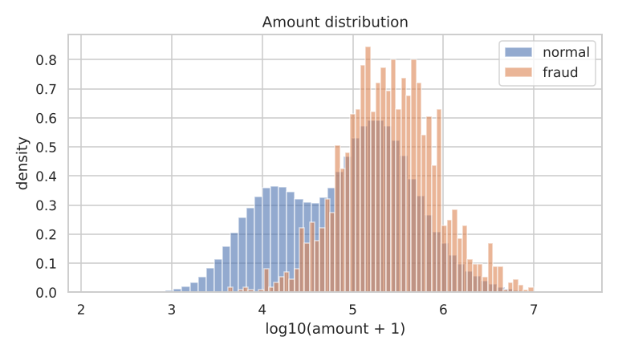
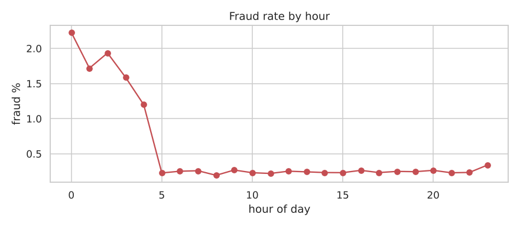
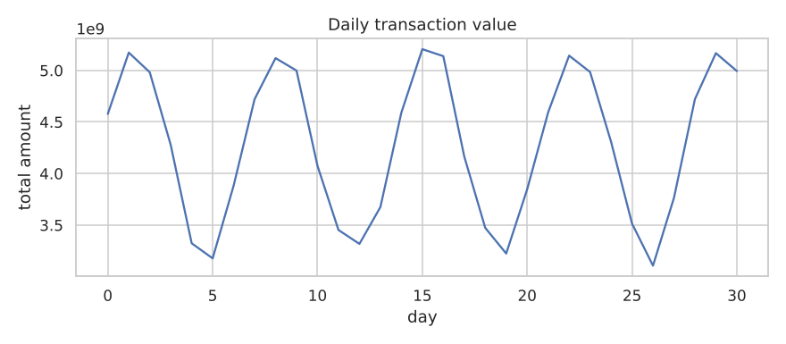

# AuditLens data-quality report

- Rows in: **500,100**, rows after cleaning: **500,000**
- Duplicates removed: 100
- Nulls imputed: {'oldbalanceDest': 125}
- Negative values clipped: none
- Fraud rate: **0.4000%** (2,000 cases) — heavy class imbalance
- PaySim's built-in `isFlaggedFraud` rule catches 0 of 2000 frauds (recall 0.00%) — the rule-based baseline any model must beat.

## Schema validation (Pandera, raw data)

No failures.

## Column profile (raw)

| column         | dtype   |   nulls |   null_pct |   unique |    min |           max |
|:---------------|:--------|--------:|-----------:|---------:|-------:|--------------:|
| step           | int64   |       0 |      0     |      744 |   1    | 744           |
| type           | object  |       0 |      0     |        5 |        |               |
| amount         | float64 |       0 |      0     |   494079 | 133.69 |   3.05888e+07 |
| nameOrig       | object  |       0 |      0     |   216094 |        |               |
| oldbalanceOrg  | float64 |       0 |      0     |   350676 |   0    |   1.06342e+08 |
| newbalanceOrig | float64 |       0 |      0     |   240918 |   0    |   1.06129e+08 |
| nameDest       | object  |       0 |      0     |   195316 |        |               |
| oldbalanceDest | float64 |     125 |      0.025 |   327611 |   0    |   3.72553e+08 |
| newbalanceDest | float64 |       0 |      0     |   273097 |   0    |   3.72645e+08 |
| isFraud        | int64   |       0 |      0     |        2 |   0    |   1           |
| isFlaggedFraud | int64   |       0 |      0     |        1 |   0    |   0           |

## By transaction type

| type     |           n |            total |     fraud |   fraud_rate |
|:---------|------------:|-----------------:|----------:|-------------:|
| CASH_IN  | 109813.0000 | 27907780394.8600 |    0.0000 |       0.0000 |
| CASH_OUT | 174815.0000 | 47718049290.3300 | 1674.0000 |       0.0096 |
| DEBIT    |   4999.0000 |    41581696.4400 |    0.0000 |       0.0000 |
| PAYMENT  | 170322.0000 |  3322331925.3800 |    0.0000 |       0.0000 |
| TRANSFER |  40051.0000 | 53703362300.6600 |  326.0000 |       0.0081 |

Fraud only occurs in TRANSFER and CASH_OUT — features and models should reflect that.

## Balance-identity violations (oldbalanceOrg - amount != newbalanceOrig)

| type     |           n |   rate |
|:---------|------------:|-------:|
| CASH_OUT | 132133.0000 | 0.7558 |
| DEBIT    |   1855.0000 | 0.3711 |
| PAYMENT  |  75500.0000 | 0.4433 |
| TRANSFER |  35710.0000 | 0.8916 |

These are frequent in PaySim even for normal rows, so the *error* term is used as a feature rather than a reason to drop rows.

## Figures

